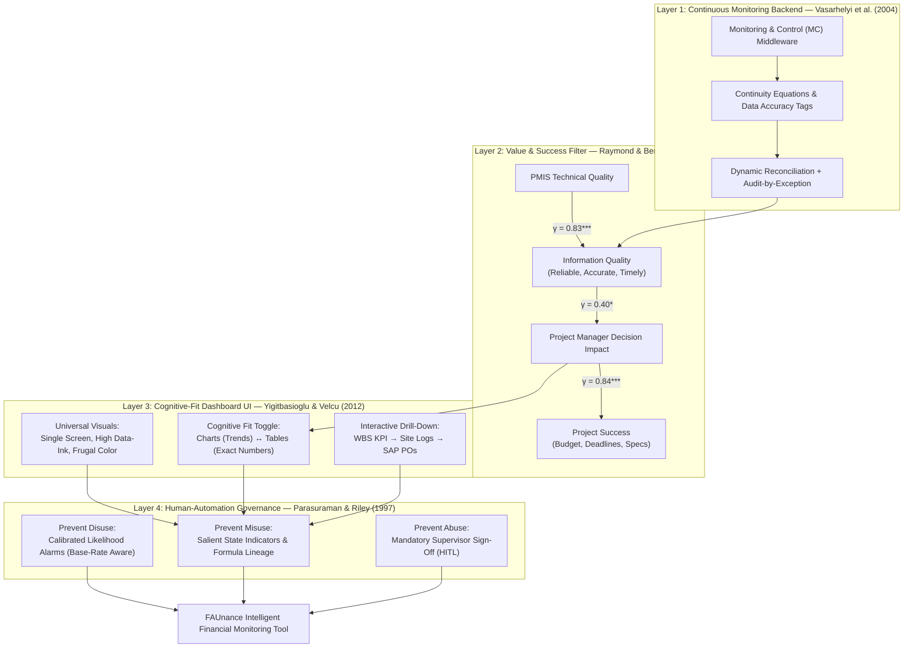

# FAUnance: Tool Design, Visualization & Human-Automation Architecture
## Master Literature Specification: Continuous Monitoring, PMIS Success, Dashboard UX, and HITL Governance

> **Author:** Hossein Hosseinpour 
> **Course Alignment:** Designing Technology (57074) — WiSe 2026/27 (Chair Wi1, FAU)  
> **Target Artifact:** Case B — **FAUnance** (Intelligent Financial Monitoring)  
> **Companion Document:** `business-strategy-engine.md` (Deterministic Valuation & Accounting Engine)  
> **Purpose:** Shared GitHub reference translating our 4 core Tool Design papers into concrete architecture, UI, and governance rules.

---

## ⚡ TL;DR for Teammates (Read This First)

> [!NOTE] **What is this document?**  
> While `business-strategy-engine.md` defines the **accounting math** (EBITDA, EVA, DCF), this document defines **how the software tool itself must be built** so project managers actually trust the data, understand the screen at a glance, and stay in control of financial decisions.

### The Analogy: Flight Sensors, Cockpit Display, and Pilot Authority
If `business-strategy-engine.md` is the **flight physics engine**, these 4 papers define the rest of the aircraft:
1. **Vasarhelyi et al. (2004) — The Live Sensor Layer:** Don't wait until month-end accounting close to discover a crash. Continuously monitor ERP/site flows and flag *only* anomalies (**Audit-by-Exception**).
2. **Raymond & Bergeron (2008) — The Accuracy Rule:** Buying fancy software doesn't save projects. Software only drives budget/schedule success when it produces **reliable, accurate, timely information** that improves the manager's decisions.
3. **Yigitbasioglu & Velcu (2012) — The Cockpit Screen:** Humans can only process ~3–4 cues at once. Keep the dashboard on **one clean screen**, use **charts** for trends and **tables** for exact accounting numbers, and allow **click-to-drill-down** to raw invoices.
4. **Parasuraman & Riley (1997) — The Pilot-in-Command Rule:** Too many false alarms make managers ignore the tool (**Disuse**); opaque black-box AI makes them stop checking the math (**Misuse**); removing human authority causes system failure (**Abuse**). Keep the human supervisor firmly in the loop.

---

## 🗺️ System Architecture Concept Map (GitHub-Native Mermaid)

---

## 🛠️ Master Design Matrix: Translating Theory into FAUnance Specs

| Tool Layer | Anchor Paper | Core Scientific Principle | Concrete FAUnance Design Spec |
| :--- | :--- | :--- | :--- |
| **1. Data & Monitoring Engine** | Vasarhelyi et al. (2004) | Continuous MC layer, continuity equations, data tagging, audit-by-exception | Two-Speed Reconciliation (`ESTIMATED` site logs vs. `CONFIRMED` SAP invoices) + automated $\Delta$ checks |
| **2. Core Value Driver** | Raymond & Bergeron (2008) | Information Quality ($\gamma=0.83$) $\rightarrow$ PM Impact ($\gamma=0.40$) $\rightarrow$ Project Success ($\gamma=0.84$) | Deterministic accounting formulas (zero LLM math hallucination) prioritized over feature bloat |
| **3. Dashboard Interface** | Yigitbasioglu & Velcu (2012) | Universal visual clarity + Cognitive Fit (Graphs vs. Tables) + Drill-down | Single-screen overview, high data-ink ratio, Chart/Table toggle, WBS-to-Invoice drill-down |
| **4. Human-AI Governance** | Parasuraman & Riley (1997) | Prevent Use-overhead, Misuse (bias), Disuse (false alarms), & Abuse (out-of-loop) | Calibrated likelihood alerts + full formula lineage + mandatory supervisor sign-off gate |

---

## 📚 Deep Dive: The 4 Anchor Papers for Tool Design

### Paper 1: Continuous Monitoring & Backend Architecture
* **Citation:** Vasarhelyi, M. A., Alles, M. G., & Kogan, A. (2004). Principles of analytic monitoring for continuous assurance. *Journal of Emerging Technologies in Accounting*, 1(1), 1–21. *(Conceptual & Architectural Framework)*
* **💡 In Plain English:** Traditional financial checking happens *after* the month is over—when the money is already gone. Instead, place a real-time "watchdog layer" over ERP and operational systems that checks whether numbers flow logically from step to step, stamps each number with a reliability tag, and stays quiet until an anomaly occurs.
* **Core Findings & Mechanisms:**
  * **Monitoring & Control (MC) Layer:** An 8-component middleware overlay (data capture, filtering, relational storage, measurement standards, inference engine, analytics, alarming, reporting) sitting across ERP, legacy, and web systems.
  * **4 Levels of Analytic Monitoring:** Ranges from **Level 1** (high automation: transactional verification) and **Level 2** (mixed: compliance rules) to **Level 3** (mixed: estimate & aggregate consistency) and **Level 4** (low automation: high-level human judgment facilitation).
  * **Key Analytic Tools:** **Continuity Equations** (modeling structural links across business processes), **Data Accuracy Tagging** (metadata indicating source and reliability level), **Dynamic Reconciliation** (daily/event-driven instead of static month-end), and **Audit-by-Exception** (evergreen status until an alarm triggers).
  * **Tertiary "Black Box" Logging:** Maintaining an immutable audit trail of system events and interventions.
* **Caveat / Boundary:** Moving to continuous monitoring requires upfront process mapping/reengineering; higher-level estimates and judgments (Levels 3–4) cannot be fully automated and require human intervention.
* **Direct Application in FAUnance:**
  * Grounds our **Two-Speed Reconciliation Engine** (daily edge telemetry reconciled dynamically against month-end SAP invoices).
  * Justifies explicit **Data Accuracy Tags** (`ESTIMATED` vs. `CONFIRMED`) on every cost record.
  * Structures our **Audit-by-Exception** alert gate (e.g., triggering only when Actual EBITDA Margin drops >2.0% below target).

---

### Paper 2: Why Information Quality Beats Feature Bloat
* **Citation:** Raymond, L., & Bergeron, F. (2008). Project management information systems: An empirical study of their impact on project managers and project success. *International Journal of Project Management*, 26(2), 213–220. *(Empirical Survey + PLS-SEM, n = 39)*
* **💡 In Plain English:** Simply giving project managers expensive software—or forcing them to log into it every day—does *not* make projects stay on budget. Software only works if it feeds managers **trustworthy, accurate, and timely information** that helps them make better decisions.
* **Core Findings & Mechanisms:**
  * Adapts DeLone & McLean's IS Success Model (ISSM) and Davis's TAM to Project Management Information Systems (PMIS) across 5 constructs.
  * **No Direct Shortcut to Success:** Technical system quality does *not* directly drive usage ($\gamma = 0.09$, n.s.) or managerial impact ($\gamma = 0.20$, n.s.), and frequency of system use has **zero direct effect** on project success ($\gamma = 0.00$, n.s.).
  * **The Real Causal Chain:** System Quality strongly drives **Information Quality** ($\gamma = 0.83, p < 0.001$) $\rightarrow$ Information Quality drives PMIS Use ($\gamma = 0.62, p < 0.01$) and **Managerial Impact** ($\gamma = 0.40, p < 0.05$) $\rightarrow$ Managerial Impact strongly drives **Project Success** ($\gamma = 0.84, p < 0.001$, $R^2 = 0.70$).
  * **What Managers Value Most:** Ease of use (33%) for system quality; **Reliability (44%)** and **Relevance (21%)** for information quality; better monitoring (46%) and planning (41%) for daily work; meeting deadlines (59%) and respecting budgets (41%) for project outcomes.
  * **Behavioral Note:** Highlights managers' reluctance to report "bad news," which distorts manual project status reports.
* **Caveat / Boundary:** Small convenience sample ($n = 39$ Canadian project managers), cross-sectional design (shows structural association rather than strict longitudinal causality), and self-reported perceptual metrics.
* **Direct Application in FAUnance:**
  * Validates our **Zero-Hallucination Deterministic Math Core**—prioritizing data reliability and timeliness over flashy AI chat features.
  * Counters "bad news reluctance" by capturing objective daily site telemetry before manual month-end filtering occurs.

---

### Paper 3: Dashboard Visualization & Cognitive Fit
* **Citation:** Yigitbasioglu, O. M., & Velcu, O. (2012). A review of dashboards in performance management: Implications for design and research. *International Journal of Accounting Information Systems*, 13(1), 41–59. *(Multidisciplinary Literature Review)*
* **💡 In Plain English:** Managers drown in competing ERP and BI reports, yet human working memory can only track about 3–4 metrics at once. A great dashboard puts critical signals on **one uncluttered screen**, uses **charts** for spotting trends and **tables** for exact financial figures, and lets users click any number to inspect the raw data underneath.
* **Core Findings & Mechanisms:**
  * **Information Overload (Inverted-U):** Both too little and too much data degrade decision accuracy and consistency.
  * **Universal Visual Design Rules (Always Apply):** Single-screen layout, **high data-ink ratio** (eliminate decorative 3D/chartjunk), frugal use of color, Gestalt grouping principles, gridlines in 2D/3D graphs (to prevent visual illusions like the Poggendorff illusion), and performance markers (`+` / `-`) to counter metric bias.
  * **Cognitive Fit Theory (Contingent Functional Features):**
    * **Graphs** outperform tables for *spatial tasks* (comparisons, trend spotting, forecasting) and for users with *low* accounting knowledge.
    * **Tables** outperform graphs for *symbolic/complex tasks* (extracting exact values, building consensus) and for users with *high* cost-accounting knowledge.
  * **Flexibility Over Static Personality Profiling:** Evidence for tailoring static UIs to personality types (e.g., MBTI) is weak. Instead, build **interactive flexibility** (format switching + **drill-down** to OLAP/granular data + **zoom-out** to strategy + optional theory-guided prompts).
  * **Dysfunctional Side Effect:** Continuous supervisor monitoring via dashboards can trigger the **Status Quo Effect** (defensive/conservative decisions) and stress—mitigated via training, procedural evaluation, and workflow integration.
* **Caveat / Boundary:** Reviews existing IS/accounting studies rather than testing a single new prototype; empirical evidence on advanced visual formats (treemaps, SOMs) remains mixed.
* **Direct Application in FAUnance:**
  * **Single-Screen Executive View:** Clean, high data-ink ratio KPI header (EBITDA, Burn Rate, Cash Runway) without visual clutter.
  * **Chart ↔ Table Toggle:** Serves both site engineers (visual S-curves/trends) and financial controllers (exact tabular WBS variance breakdowns).
  * **Click-to-Drill-Down:** Seamless trace from Project Margin $\rightarrow$ Work Package $\rightarrow$ Daily Site Receipts & SAP Purchase Orders.

---

### Paper 4: Human-Automation Interaction & HITL Governance
* **Citation:** Parasuraman, R., & Riley, V. (1997). Humans and automation: Use, misuse, disuse, abuse. *Human Factors*, 39(2), 230–253. *(Theoretical & Empirical Human-Factors Synthesis)*
* **💡 In Plain English:** Automation doesn't replace human error—it changes it. If a system is annoying to set up, people won't use it; if it cries wolf with false alarms, people turn it off (**Disuse**); if it's usually right and opaque, people stop paying attention (**Misuse**); and if designers take away human control, one software bug becomes a disaster (**Abuse**).
* **Core Findings & Mechanisms:**
  * **Use (Activation):** Driven by trust, reliability, self-confidence, workload, and **cognitive overhead** (if configuring or verifying the tool takes too much effort, operators revert to manual work). Large individual differences make usage hard to predict.
  * **Misuse (Overreliance):** High, constant reliability breeds complacency, **monitoring failures**, and **automation bias** (omission errors when the tool misses a fault; commission errors when users blindly follow a wrong recommendation). Mitigated via **display integration** (salient deviation indicators) and keeping humans actively involved.
  * **Disuse (Neglect / Alarm Fatigue):** Even highly sensitive alerting systems generate mostly false alarms when the **base rate** of real anomalies is low (Bayesian posterior probability drops sharply). Operators respond slowly or disable alarms. Remedy: account for base rates and use **Likelihood Alarms** (graded probability/severity levels instead of binary on/off alerts).
  * **Abuse (Technology-Centered Design):** Automating functions purely for cost/efficiency without preserving human situational awareness and fiduciary authority simply replaces *operator error* with *designer error*.
* **Caveat / Boundary:** Grounded primarily in safety-critical operational domains (aviation, maritime, process control); translating to corporate finance requires adapting "safety authority" to "budgetary and audit accountability."
* **Direct Application in FAUnance:**
  * **Use:** Low-friction mobile logging for field teams (minimizing cognitive overhead).
  * **Anti-Disuse:** **Calibrated Confidence / Likelihood Alerts** (Best/Base/Worst-case EBITDA trajectories) rather than noisy binary warnings.
  * **Anti-Misuse:** Transparent **XAI Exception Narratives** linked directly to underlying EV/AC formulas and source records.
  * **Anti-Abuse:** **Mandatory Supervisor Sign-Off (HITL Gate)**—FAUnance flags exceptions and drafts narratives, but never autonomously alters budgets or approves invoices.